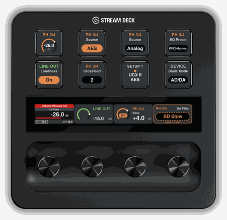
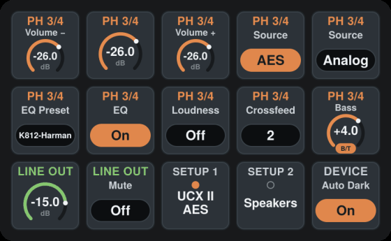
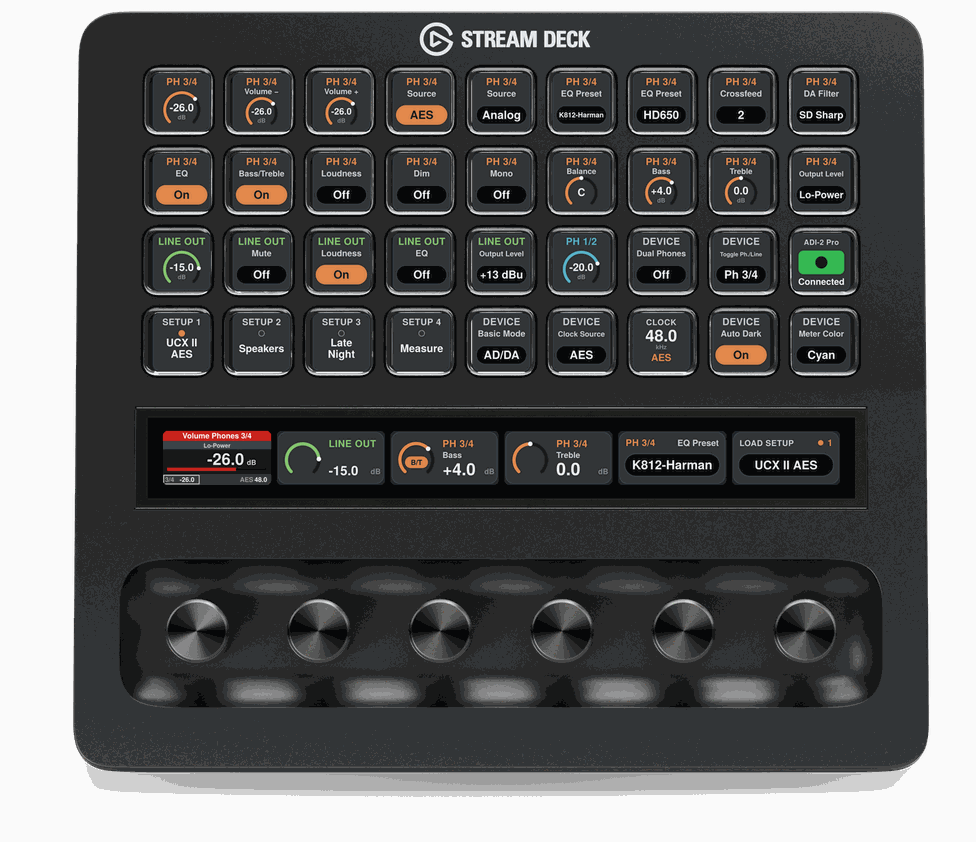

  

# ADI-2 Control (unofficial Stream Deck plugin)

## What Is This (and what does it do?)

It's a plugin for the [Elgato Stream Deck][Stream Deck] on Windows and macOS that puts an [RME ADI-2][] converter on your keys and dials: volume, mute, source, EQ presets, loudness, setups and almost every setting from the unit's menus, with live values read from the unit, so the deck always shows what the ADI-2 is doing.

Works with the ADI-2 Pro EX, ADI-2 Pro FS / FS R BE, ADI-2/4 Pro SE and ADI-2 DAC.

## Release / Installation

Install it from the Elgato Marketplace inside the Stream Deck app, or download the plugin file from the GitHub Release and open it; either way it lands in Stream Deck's action list as *ADI-2 Control*.

Requires Stream Deck 7.1 or newer on Windows 10+ or macOS 12+, and the ADI-2 connected to the same computer by USB. On Windows, RME's MADIface series driver must be installed (the same one ADI-2 Remote needs). No other software is needed.

## Setup

1. Update the ADI-2 to the latest firmware (RME's Flash Update Tool, rme-audio.de → Downloads).
2. On the unit, set **SETUP → Options → Device Mode / DSD → MIDI Control → ON**. On the ADI-2 DAC this is under *Remap Keys / Diag*.
3. Drag an action onto a key or dial and pick the **Output** and **Function**, for example *Phones 3/4 → Volume*. The key shows the unit's current value straight away, and the status line at the bottom of the settings says *Connected*.

Everything technical sits in a collapsed *Advanced* section of each action; you normally don't need it.

## Actions

| Action | Where | What it does |
|---|---|---|
| Level | Key or dial | Volume, bass, treble, balance, width, loudness, every parametric EQ band and input trim, per output. Rotate to adjust, push and turn for fine steps (0.1 dB on volume). Push / tap is assignable: mute, reset to 0 dB or centre, Recall, or Loudness / EQ / Bass-Treble / Dim on/off. Keys mute, step up or down, recall a value, or switch one of those on/off. |
| Setting | Key or dial | Source, output level / Hi-Power, crossfeed, DA and AD filter, mono, polarity, EQ and EQ preset, Bass/Treble, loudness, dim, mute, plus device settings like Basic Mode, clock source, SPDIF input, SRC, Dual / Balanced Phones, Auto Dark and display. A key steps through the options, selects one option and lights while it is active, or switches between two. On a dial: turn to choose and push to confirm, or change directly. |
| Load Setup | Key or dial | Loads one of the unit's nine stored setups, shown by the name stored in the unit. The setup last loaded from Stream Deck is marked. |

**Recall and Link** work like in ADI-2 Remote, where they are app features too: Recall jumps to a stored value and back on the next press; a volume can be linked to other outputs so they move and mute together.

When a key steps through options, those the unit refuses at the moment, such as a source without a signal, are skipped.

## Look

Under *Advanced → Look* in any action:

- **Colours**: follow the unit's *Meter Color* (default), or ADI-2 Remote's colours per output. Change Meter Color on the unit and the deck follows.
- **Level style**: ADI-2 Remote knobs; the unit's volume screen; or the knob, switching to the unit's volume screen while a value changes (default). The volume screen follows the unit's *Display Mode* (Default / Dark).

## Layout examples

A standard Stream Deck (5 × 3) set up for headphone listening: volume down / volume / up for Phones 3/4, two keys that switch the phones between AES and Analog like radio buttons (say two PCs), EQ preset, EQ, loudness, crossfeed and bass. The bottom row has the speaker volume and mute, two setups and Auto Dark.

A Stream Deck + XL (9 × 4 keys, six dials) has room for the rest: filters, Bass/Treble, balance, output level and Hi-Power, Line Out with loudness and EQ, Phones 1/2, the headphone/line switching options, four setups and the device settings. The dials carry the phones volume (here in the unit-display look), the line out, bass, treble, an EQ preset browser and the setup loader.

## Good to know

- **No level meters.** The ADI-2 doesn't send audio levels over MIDI, only settings.
- **Changes made in RME's ADI-2 Remote** reach the deck within 15 seconds; the unit doesn't announce them to other programs. Changes on the unit itself or by IR remote show up immediately.
- **Windows: "PORT BUSY"** means another program (usually ADI-2 Remote or a DAW) has the ADI-2's MIDI port open. Windows lets one program use a MIDI port at a time; close the other one. macOS and Windows 11 with Windows MIDI Services don't have this limit.
- **DAWs**: if a DAW uses the ADI-2's MIDI port as an input (reported with Logic Pro), the unit may ignore the deck while audio plays. Disable that MIDI input in the DAW.
- The plugin follows RME's published MIDI table for the ADI-2 series. The ADI-2 Pro EX identifies itself as an ADI-2 Pro and works the same way.

# I have an issue or miss a feature?

You can submit an issue or request a feature with [GitHub issues]. Please describe as precisely as possible what went wrong and also include the log file, it is incredibly helpful for me to figure out what went wrong. Logs can be found in `%APPDATA%\Elgato\StreamDeck\Plugins\de.shells.adi2control.sdPlugin\logs` on Windows and `~/Library/Application Support/com.elgato.StreamDeck/Plugins/de.shells.adi2control.sdPlugin/logs` on macOS.

If a setting shows the wrong name or doesn't react, the *MIDI monitor* under *Advanced* in the action's settings shows what goes to and comes from the unit; a copy of that helps too.

# Contribute

If you're interested in using this plugin but something you really need is missing, let me know. I don't have access to every ADI-2 model, so I can't try things on all the boxes myself, but eventually we might find a way to work something out.

# Support

If you'd like to drop me a coffee for the hours I've spent on this:  

# Disclaimer

This is a private project, I am not affiliated with RME or Elgato. I wrote this plugin out of personal interest.

<!-- Reference Links -->

[Stream Deck]: https://www.elgato.com/gaming/stream-deck/ "Elgato's Stream Deck product page"
[RME ADI-2]: https://www.rme-audio.de/converter/adi-2-pro-ex.html "RME's ADI-2 Pro EX product page"
[GitHub issues]: https://github.com/shells-dw/streamdeck-adi2/issues "GitHub issues link"
